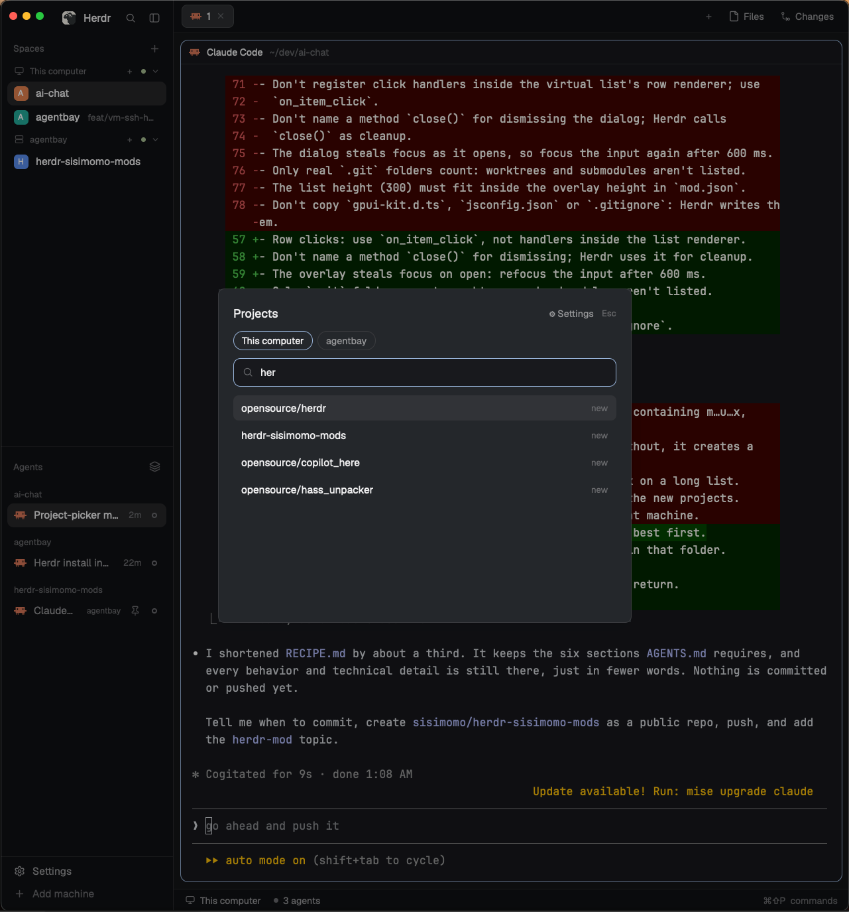

# Project Picker

Press a key, type a project's name, hit Enter. Herdr jumps to the space
already working in that git project, or opens a new one there. Works on this
computer and any connected machine.

## What you see

A small dialog floats over your work: a search box at the top and your git
projects listed below it. Projects that already have a space say "open", the
rest say "new". With other machines connected, small pills let you switch
between them. A "⚙ Settings" link lets you change which folder is scanned.

## How it behaves

- Typing filters loosely ("mux" finds `tools/tmux-config`); several words
  must all match; best matches first.
- ↑/↓ move (wrapping). Enter or click opens: focuses the project's space, or
  creates one named after the project, in that folder.
- A machine chip, or Tab (Shift+Tab goes back), switches machine. What you've
  typed stays and is searched on the new machine. The dialog starts on the
  current space's machine.
- ctrl+, toggles settings. Esc goes back, then closes. Changed settings
  re-scan on return.

## Built from

- `mods/project-picker/`: `mod.json`
  `{ "place": "none", "overlay": { "width": 520, "height": 420 } }`, `main.js`
  (state, keys), `config.js`, `projects.js`, `fuzzy.js`, `ui.js`,
  `settings-ui.js`, `search.svg`.
- `keys.json`: `{ "global": { "cmd-n": "mod.open:project-picker" } }`. Merge
  into the person's file; ask before replacing an existing `cmd-n`.
- Look: popover background, 18 px padding, 15 px semibold title, 24 px chips,
  36 px search box with accent border, virtual list of 34 px rows filling the rest of the dialog.
- Scan: `find` under the root on the chosen machine (`exec` with `on`), skipping
  ignored names/globs/paths and stopping at `.git`. Defaults: root `~`, depth
  4, ignore `node_modules`, `Library`, `.Trash`, `.cache`.
- Open: `run("space.select", { id })` if a space's folder or a terminal's
  `cwd` is the project, else `run("space.new", { name, folder, machine })`.
- Settings: `setShared("project-picker.config", …)`, this computer's at the
  top level, others under `machines`.
- Runs `find` and `sh` (read-only). No network.

## Watch out

- Row clicks: use `on_item_click`, not handlers inside the list renderer.
- Tab never reaches `on_key_down` (the window uses it to move focus): bind it
  with `cx.bind_keys` (`tab`, `shift-tab`) in a `key_context` on the root, and
  handle it with `on_action`.
- Don't name a method `close()` for dismissing; Herdr uses it for cleanup.
- The overlay steals focus on open: refocus the input after 600 ms.
- Only `.git` folders count; worktrees and submodules aren't listed.
- The list and settings page fill the space under the search box (`flex_1`, `min_h_0`); the list reports its real height with `on_size_change` for arrow-key scrolling.
- Don't copy `gpui-kit.d.ts`, `jsconfig.json` or `.gitignore`.

## Done when

- `herdr-app check mods/project-picker` passes.
- The key opens it; "mux" lists paths containing m…u…x, best first.
- Enter focuses an existing space or creates a new one in that folder.
- Wheel and arrow-key scrolling work on a long list.
- Changing the folder in settings shows new projects on return.
- A second machine's chip, or Tab, searches that machine and keeps the typed text.
